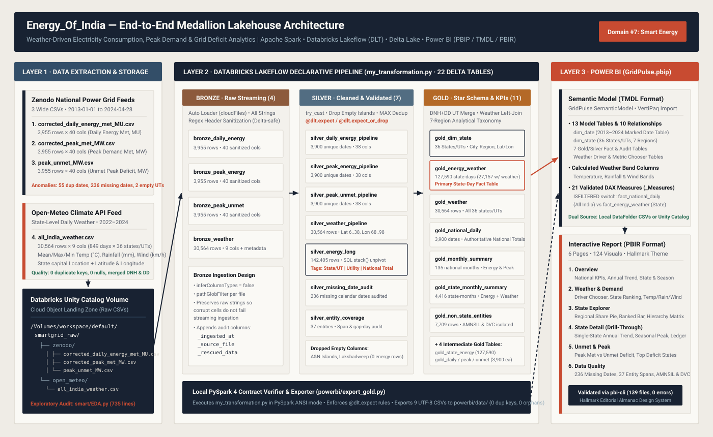
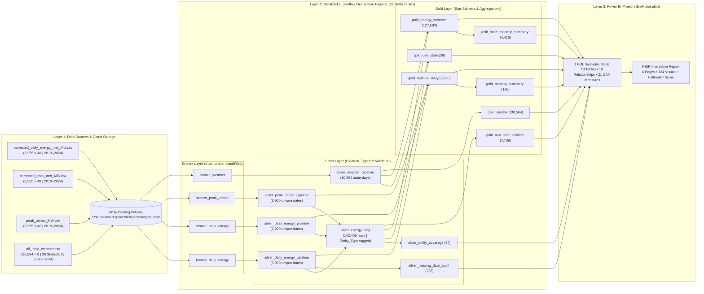

# Energy_Of_India: A Medallion Lakehouse Architecture for Weather-Driven Electricity Consumption, Peak Demand, and Grid Deficit Analytics

**Domain #7:** Energy – Smart Electricity Consumption Analytics  
**Stack:** Python • Apache Spark (PySpark 4) • Databricks Lakeflow Declarative Pipelines (`dlt`) • Delta Lake • Unity Catalog • Power BI Project (`PBIP` / `TMDL` / `PBIR`)



---

## 1. Real-World Context & Problem Statement

Managing a national power grid requires balancing daily electricity consumption (**Million Units, MU**), sudden peak demand surges (**Megawatts, MW**), and regional supply-demand deficits (**Unmet Peak Demand, MW**) across diverse climatic zones. In India, grid operators and energy planners frequently analyze load data in isolation from meteorological drivers—such as extreme heatwaves, monsoon precipitation, and wind patterns—making it difficult to quantify what triggers regional load spikes and grid shortfalls.

### Raw Data Engineering Challenges (Bronze & Silver Realities)
Integrating multi-source national energy datasets (**Zenodo** daily energy met, peak power met, and peak unmet records from `2013-01-01` to `2024-04-28`) with state-level daily meteorological feeds (**Open-Meteo** climate data from `2022-01-01` to `2024-04-28`) introduces five core data engineering challenges:

1. **Schema & Ingestion Friction:** Raw wide-format CSV headers contain spaces (`Andhra Pradesh`, `Tamil Nadu`, `Damodar Valley Corporation`) that violate Delta Lake column naming standards during automated streaming ingestion (`cloudFiles`).
2. **Duplicate & Conflicting Date Records:** Each of the three raw energy CSVs (`3,955` rows × `40` columns) contains **`55` repeated `Date` rows** (`43` / `43` / `47` exact duplicates plus `12` / `12` / `8` conflicting-value duplicate dates) that would distort aggregations if left uncollapsed.
3. **Structural Sparsity & Reporting Gaps:** Two Union Territories (`Andaman and Nicobar Islands` and `Lakshadweep`) are completely empty (`100% NULL`) across all three energy feeds, `236` calendar dates are absent across the 11-year reporting span, and entities like `Telangana` and `AMNSIL` start reporting mid-span.
4. **Mixed Entity Granularity:** The wide-format energy tables mix `34` State/UT columns with non-state industrial/utility entities (`AMNSIL` and `Damodar Valley Corporation`) and an explicit national `Total` column (which diverges from the sum of states on `~814` days).
5. **Jurisdictional & Temporal Mismatches:** The energy feeds report `Dadra and Nagar Haveli` and `Daman and Diu` separately, whereas Open-Meteo reports the merged UT `Dadra and Nagar Haveli and Daman and Diu` (and includes `Ladakh`, which has no energy column).

---

## 2. System Architecture & Medallion Pipeline Lineage



---

## 3. Medallion Layer Table Inventory (`smart/transformations/my_transformation.py`)

### Bronze Layer (4 Streaming Delta Tables)
Ingested via Databricks Auto Loader (`cloudFiles`) with `inferColumnTypes=false` (preserving raw strings so malformed cells never break streaming ingestion), regex column sanitization (`sanitize_column_name`), and `_ingested_at` / `_source_file` audit metadata:

| Table | Source Path | Rows | Description |
| :--- | :--- | ---: | :--- |
| `bronze_daily_energy` | `.../zenodo/corrected_daily_energy_met_MU.csv` | `3,955` | Raw daily electricity consumption met (MU), headers sanitized. |
| `bronze_peak_energy` | `.../zenodo/corrected_peak_met_MW.csv` | `3,955` | Raw daily peak demand met (MW), headers sanitized. |
| `bronze_peak_unmet` | `.../zenodo/peak_unmet_MW.csv` | `3,955` | Raw daily unmet peak demand deficit (MW), headers sanitized. |
| `bronze_weather` | `.../open_meteo/all_india_weather.csv` | `30,564` | Raw Open-Meteo daily state weather observations. |

### Silver Layer (7 Validated & Normalized Delta Tables)
Casts types safely with `try_cast`, drops the two completely unpopulated island columns (`Andaman_and_Nicobar_Islands`, `Lakshadweep`), collapses duplicate dates deterministically via per-column `MAX(...)`, enforces `@dlt.expect` and `@dlt.expect_or_drop` data quality constraints, and unpivots wide entity columns:

| Table | Grain | Rows | Validation & Transformation Logic |
| :--- | :--- | ---: | :--- |
| `silver_daily_energy_pipeline` | `Date` | `3,900` | Drops empty islands, deduplicates 55 repeated dates, checks `valid_date`, `national_total_present`, `non_negative_total`. |
| `silver_peak_energy_pipeline` | `Date` | `3,900` | Typed and deduplicated daily peak power met (MW) with DLT expectations. |
| `silver_peak_unmet_pipeline` | `Date` | `3,900` | Typed and deduplicated daily peak unmet demand (MW); flags 26 negative source anomalies. |
| `silver_weather_pipeline` | `(Date, State)` | `30,564` | Validates `temperature_2m_max >= temperature_2m_min`, `precipitation_sum >= 0`, and India bounding box (`Lat 6..38`, `Lon 68..98`). |
| `silver_energy_long` | `(Date, Entity)` | `142,405` | Unpivots all 3 energy tables via SQL `stack(...)` and classifies `Entity_Type` into `State/UT`, `Utility/Industrial`, or `National Total`. |
| `silver_missing_date_audit` | `Date` | `236` | Left-anti join against a continuous calendar sequence (`2013-01-01`..`2024-04-28`) isolating all 236 missing reporting dates. |
| `silver_entity_coverage` | `Entity` | `37` | Computes `First_Date`, `Last_Date`, `Days_Reported`, `Span_Days`, and `Gap_Days_In_Span` per entity. |

### Gold Layer (11 Analytics-Ready Delta Tables)
Separates non-state utilities and national totals from state-level facts, merges `Dadra and Nagar Haveli` + `Daman and Diu` to match Open-Meteo's Post-2020 UT taxonomy, maps all 36 states/UTs into 7 analytical regions (`North`, `South`, `East`, `West`, `Central`, `North-East`, `Islands`), and left-joins weather onto state energy:

| Table | Grain | Rows | Purpose in Analytics & Power BI |
| :--- | :--- | ---: | :--- |
| `gold_dim_state` | `State` | `36` | State/UT dimension with capital `City`, `Region`, `Latitude`, `Longitude`, `Has_Energy` (`33`), and `Has_Weather` (`36`). |
| `gold_energy_weather` | `(Date, State)` | `127,590` | Primary fact table joining `gold_state_energy` with `gold_weather` (`27,157` weather-matched rows from `2022–2024`; `2013–2021` history preserved). |
| `gold_weather` | `(Date, State)` | `30,564` | Daily weather observations across all 36 states/UTs (`2022-01-01`..`2024-04-28`), including weather-only UTs (`Ladakh`, `Lakshadweep`, `A&N Islands`). |
| `gold_national_daily` | `Date` | `3,900` | Authoritative national daily totals (`Daily_Energy_Total`, `Peak_Energy_Total`, `Unmet_Energy_Total`). |
| `gold_monthly_summary` | `(Year, Month)` | `135` | Pre-aggregated national monthly consumption, peak demand, and unmet deficit KPIs. |
| `gold_state_monthly_summary` | `(State, Year, Month)` | `4,416` | Pre-aggregated state-month energy, peak, unmet days, and weather summary. |
| `gold_non_state_entities` | `(Date, Entity)` | `7,709` | Isolated utility/industrial records (`AMNSIL` and `Damodar Valley Corporation`). |
| `gold_state_energy` | `(Date, State)` | `127,590` | Normalized state-grain energy table prior to weather join. |
| `gold_daily_energy` / `gold_peak_energy` / `gold_peak_unmet` | `Date` | `3,900` each | Individual national daily series feeding `gold_national_daily`. |

---

## 4. Power BI Interactive Dashboard (`powerbi/GridPulse.pbip`)

Built in source-controlled **PBIP** format (**TMDL** semantic model + **PBIR** report definition) and styled with the **Hallmark Editorial Almanac** design system:

- **Semantic Model (`powerbi/GridPulse.SemanticModel/`):**
  - `13` tables (`dim_date`, `dim_state`, `fact_energy_weather`, `fact_weather`, `fact_national_daily`, `gold_monthly_summary`, `gold_state_monthly_summary`, `silver_missing_date_audit`, `silver_entity_coverage`, `gold_non_state_entities`, disconnected `'Weather Driver'` & `Metric` choosers, and `_Measures`).
  - `10` active many-to-one star-schema relationships and `2` drill hierarchies (`Calendar Hierarchy`, `Location Hierarchy`).
  - `21` validated DAX measures with `ISFILTERED` context switching (reading `fact_national_daily` for unfiltered All-India totals and `fact_energy_weather` when sliced by Region, State, City, or Weather Band).
- **Interactive Report Pages (`powerbi/GridPulse.Report/` — 6 Pages, 124 Visuals):**
  1. **Overview:** National headline KPIs (`Total Energy (MU)`, `Peak Demand Met (MW)`, `Peak Unmet (MW)`, `Energy YoY %`, `Avg Temperature (C)`), annual demand trend (`2013–2024`), leading states bar chart, meteorological season profile, temperature band distribution, and regional summary ledger.
  2. **Weather & Demand:** Dynamic `Weather Driver` (`Avg temperature`, `Max temperature`, `Rainfall`, `Wind`) and `Chart Metric` choosers, state ranking by active weather driver, annual demand trend, and daily energy breakdowns across Temperature, Rainfall, and Wind bands.
  3. **State Explorer:** Regional demand share pie chart, ranked state comparison bar chart, and expandable `Region > State > City` performance matrix with right-click drill-through.
  4. **State Detail (Drill-Through):** Single-state deep dive showing annual energy consumption trend, seasonal peak met vs. unmet deficit, temperature-band sensitivity, and monthly historical ledger.
  5. **Unmet & Peak:** Annual peak demand met vs. peak unmet deficit comparison, highest-deficit states ranking, deficit days by temperature band & season, and state deficit ledger.
  6. **Data Quality:** Pipeline audit dashboard surfacing `Data Coverage %` (`94.3%`), `Missing Dates Count` (`236`), `Non-State Utility Energy (MU)` (`291.7K MU`), missing reporting dates by year, entity coverage & gap-day table (`37` entities), and isolated `AMNSIL` & `DVC` consumption trend.

---

## 5. Repository Structure

```text
Energy_Of_India/
├── README.md                                   # Project overview, architecture, lineage & runbook
├── architecture_diagram.svg                    # Standalone vector architecture diagram (Deliverable #8)
├── ProblemStatement.txt                        # Project title, domain context & 3-layer objectives
├── Progress.md                                 # Project progress tracker & deliverable checklist
├── manifest.mf                                 # Databricks Lakeflow pipeline export manifest
├── all_india_weather.csv                       # Raw Open-Meteo daily state weather dataset (30,564 rows)
├── corrected_daily_energy_met_MU.csv           # Raw Zenodo daily energy met dataset (3,955 rows × 40 cols)
├── corrected_peak_met_MW.csv                   # Raw Zenodo daily peak demand met dataset (3,955 rows × 40 cols)
├── peak_unmet_MW.csv                           # Raw Zenodo daily peak unmet deficit dataset (3,955 rows × 40 cols)
├── smart/
│   ├── EDA.py                                  # Databricks PySpark exploratory data analysis notebook (735 lines)
│   └── transformations/
│       └── my_transformation.py                # Databricks Lakeflow (DLT) Medallion pipeline (22 Delta tables)
└── powerbi/
    ├── GridPulse.pbip                          # Power BI Project entry file
    ├── README.md                               # Semantic model dictionary, DAX catalog & Unity Catalog guide
    ├── export_gold.py                          # Local PySpark 4 runner & Gold CSV contract verifier
    ├── data/                                   # 9 exported Gold & Silver UTF-8 CSVs for local Power BI import
    ├── GridPulse.SemanticModel/                # TMDL semantic model definitions (13 tables, 21 DAX measures)
    └── GridPulse.Report/                       # PBIR report definitions (6 pages, 124 visuals, Hallmark theme)
```

---

## 6. How to Run End-to-End

### A. Running in Databricks (Lakeflow Declarative Pipeline)
1. In your Databricks workspace (Free Edition or Unity Catalog-enabled workspace), create the Unity Catalog volume `/Volumes/workspace/default/smartgrid_raw/` with two subdirectories:
   - `/Volumes/workspace/default/smartgrid_raw/zenodo/` (upload `corrected_daily_energy_met_MU.csv`, `corrected_peak_met_MW.csv`, `peak_unmet_MW.csv`)
   - `/Volumes/workspace/default/smartgrid_raw/open_meteo/` (upload `all_india_weather.csv`)
2. Import and run `smart/EDA.py` to inspect raw schemas, missing-value counts, duplicate date rows, and empty regional columns.
3. Create a **Lakeflow Declarative Pipeline (DLT)** pointing to `smart/transformations/my_transformation.py` with target catalog `workspace` and target schema `default`, then click **Start** to materialize all 22 Bronze, Silver, and Gold Delta tables.

### B. Regenerating Gold CSVs Locally via PySpark
To execute `my_transformation.py` locally against the 4 root CSVs and verify all primary-key, foreign-key, and `@dlt.expect` constraints:
```powershell
python powerbi/export_gold.py
```

### C. Opening & Refreshing the Power BI Dashboard
1. Open `powerbi/GridPulse.pbip` in **Power BI Desktop** (March 2026 or newer).
2. If you cloned the repository to a different folder path, go to **Home → Transform data → Edit parameters**, set `DataFolder` to your local `<repo>\powerbi\data\` path, and click **Apply changes**.
3. Click **Home → Refresh** to reload all 9 CSVs into VertiPaq.

---

## 7. Data Sources, Attributions & Acknowledgments

In compliance with project originality and attribution guidelines:
- **National Electricity Consumption, Peak Demand & Deficit Datasets:** Sourced from publicly available POSOCO / Grid-India daily power supply position archives curated on **Zenodo** (`corrected_daily_energy_met_MU.csv`, `corrected_peak_met_MW.csv`, `peak_unmet_MW.csv`, covering `2013-01-01` to `2024-04-28`).
- **Meteorological Observations Dataset:** Sourced via the **Open-Meteo Historical Weather API** (`https://open-meteo.com/`, `all_india_weather.csv`, covering daily temperature, precipitation, and wind speed across 36 Indian state/UT capitals from `2022-01-01` to `2024-04-28`).
- **Platforms & Tools:** Apache Spark / PySpark, Databricks Lakeflow Declarative Pipelines (Delta Live Tables), Delta Lake, Microsoft Power BI Desktop (`PBIP` / `TMDL` / `PBIR`), and `pbi-cli`.
